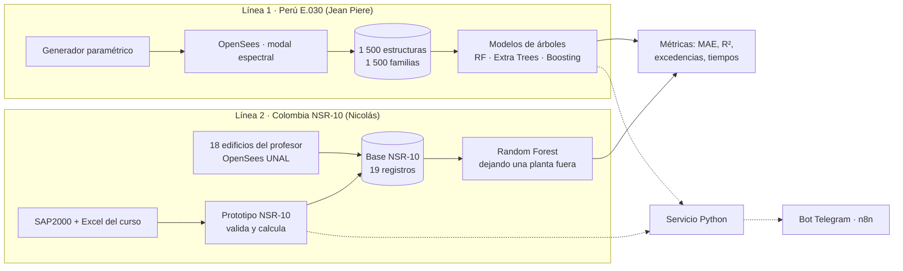

# Nexo Sísmico explicado de principio a fin

> Una nota para entender **qué estamos haciendo, por qué, cómo encaja cada pieza y qué falta**. Si solo vas a leer una nota del vault, que sea esta.

## 1. La idea en una frase
Cuando un ingeniero predimensiona un edificio de pórticos de concreto, tiene que probar varias alternativas (más pisos, otras luces, columnas más grandes) y **cada alternativa exige repetir el análisis sísmico completo** para saber si la deriva cumple. Nexo Sísmico investiga si un modelo de aprendizaje automático, entrenado con muchos análisis ya hechos, puede **estimar la deriva de una alternativa nueva en milisegundos** y con qué precisión, para descartar rápido las malas y analizar a fondo solo las prometedoras.

## 2. La pregunta de investigación
> ¿Con qué precisión Random Forest estima las derivas máximas de familias de edificios aporticados **no usadas en el entrenamiento**, y qué reducción de tiempo ofrece al comparar alternativas de predimensionamiento?

Dos palabras clave:
- **Deriva**: desplazamiento relativo entre pisos dividido por la altura del piso. Es el control sísmico que más gobierna el tamaño de columnas y vigas. Límite: 1,0 % en NSR-10 (Colombia) y 0,007 (0,7 %) en E.030 (Perú, pórticos de concreto).
- **Familia**: un edificio "tipo" (pisos, vanos, luces) con sus variantes. Evaluar con **familias reservadas** significa probar el modelo con edificios que nunca vio, que es la situación real del ingeniero. Si se probara con variantes de familias ya vistas, el modelo parecería mejor de lo que es.

**Modalidad del proyecto:** C) investigación académica aplicada (Beca AI Talent, AECODE). Se califica pregunta clara, sustento metodológico, aplicación práctica demostrable y evidencia técnica ([[Rubrica y checklist]]).

## 3. La arquitectura: una pregunta, dos líneas de evidencia, una interfaz


Por qué dos líneas que **no se mezclan**: usan normas distintas (E.030 vs NSR-10), unidades distintas (kgf-cm vs kN-m), rangos de altura distintos (2–5 pisos vs 4–10) e hipótesis distintas. Juntarlas en un solo entrenamiento produciría un modelo sin sentido físico. Se presentan como dos evidencias que responden la misma pregunta.

## 4. Cada pieza, qué hace y en qué estado está

### 4.1 Línea 1 — Generador + OpenSees + aprendizaje (E.030) · ✅ hecha
Repositorio: https://github.com/PieroVQ/ProyectoGH · revisión: [[Ruta E030 - repositorio de Piero]]
1. **Genera** edificios al azar dentro de un dominio (2–5 pisos, 2–5 vanos, luces 3–6 m, f'c 210/280, zonas sísmicas y suelos de la E.030).
2. **Predimensiona** columnas, vigas y losas con reglas de E.060 y metra cargas con E.020.
3. **Analiza** en OpenSeesPy: modos, espectro E.030, CQC, excentricidad accidental, cortante mínimo, deriva normativa (elástica × 0,75·R).
4. **Entrena** 7 configuraciones de modelos de árboles con 1 200 estructuras y prueba con 300 familias nunca vistas.
5. **Resultado (Random Forest, el modelo de la pregunta):** deriva con **MAE 0,040 % y R² 0,990**; detecta **137 de 146 edificios que exceden el límite (94 %)**, con 2 falsas alarmas; los que se le escapan tienen derivas de 0,70–0,76 %, justo en el límite. Como comparación, Gradient Boosting llega a R² 0,995 y 139 de 146.
6. **Por qué funciona tan bien:** el modelo no adivina desde cero; recibe una estimación física (periodo aproximado por rigidez de piso y espectro) y aprende a corregirla.

### 4.2 Línea 2 — Prototipo NSR-10 (Colombia) · ✅ hecho
Código: `03 Prototipo/codigo/` · notas: [[Modulo NSR-10 y SAP2000]], [[Pruebas 3 casos]]
- `nexo_nsr10.py` recibe un edificio en JSON, **valida** que esté completo y en rango, y calcula con NSR-10: espectro, Sa, periodo Cu·Ta, cortante basal, fuerzas por piso con torsión accidental (FHE), derivas con 12 combinaciones en dos esquinas, índice de estabilidad Q y R.
- **Caso de prueba:** edificio de oficinas de 5 pisos del curso (grupo 1, Bogotá, Piedemonte A). Reproduce exactamente el Excel + SAP2000: Vs = 23 250 kN, derivas 0,985 % / 0,991 % (cumple 1,0 %), Q = 0,0165.
- **Las 3 pruebas pedidas:** caso completo → calcula; falta Fv → se detiene y pide el dato; altura en centímetros → la rechaza y explica el rango.
- Cada caso válido se convierte en un **registro de la base NSR-10**.
- **App web para ingenieros** (`03 Prototipo/app/`): formulario guiado, revisión de datos en vivo, pegado de la tabla de SAP2000, dictamen con gráficas y comparación de alternativas. Ejecuta el mismo motor en el navegador; se abre con `python "03 Prototipo/app/abrir_app.py"`.

### 4.3 Base NSR-10 y aprendizaje con datos del profesor · ✅ hecho, con limitaciones
Notas: [[Datos del profesor NSR-10]], [[Random Forest]]
- 18 edificios diseñados con el algoritmo OpenSees del Prof. Thomas F. Rojas Vallejo (UNAL), más el caso del curso: **19 registros**.
- El profesor aclaró que varios son **teóricos** (luces o plantas que en la práctica no se resolverían con pórticos), así que sirven para entrenar y comparar, no como diseños.
- Random Forest evaluado **dejando una planta completa fuera**: deriva MAE 0,086 % (X) y 0,101 % (Y), R² 0,59 / 0,42; 39 % menos error que la referencia; detecta 3 de 7 edificios cerca del límite.
- **Lectura:** con 18 datos el modelo solo sirve para priorizar. Comparado con la línea E.030, muestra que **la cantidad y trazabilidad de datos es lo que decide la precisión**. Ese contraste es uno de los hallazgos del proyecto.

### 4.4 Bot de Telegram en n8n · 🟡 diseñado, sin backend
Nota: [[Bot Telegram n8n]] · flujos en `05 Datos/Piero JSON/`
- Conversación en Telegram: un LLM extrae los parámetros del edificio del mensaje, pide lo que falta, valida y genera un informe PDF.
- Le falta el **servicio Python** (`/schema`, `/consultas/validar`, `/consultas`). Ese servicio puede cargar el modelo E.030 que ya existe y el validador del prototipo NSR-10. En el informe se presenta como **interfaz propuesta**, no como sistema en producción.

## 5. Qué responde cada resultado (la historia del informe)
| Resultado | Responde | Estado |
|---|---|---|
| R1 · Precisión en familias nuevas | La pregunta central | ✅ E.030: Random Forest R² 0,990, 137 de 146 excedencias · ✅ NSR-10: R² 0,42–0,59 con 18 datos |
| R2 · Prototipo NSR-10 | ¿Se puede producir una respuesta de referencia confiable y trazable en Colombia? | ✅ Reproduce SAP2000 y bloquea entradas malas |
| R3 · Base NSR-10 | ¿Cómo se amplía el predictor a Colombia? | ✅ 19 registros con esquema común |
| R4 · Tiempo | ¿Cuánto se ahorra? | 🟡 Predicción ≈ 32 ms; análisis automático ≈ 0,17 s por estructura; **falta cronometrar el flujo manual en SAP2000** (Joseph) |

**Conclusión que sostienen los datos:** dentro del dominio entrenado, Random Forest con variables físicas estima la deriva de edificios nuevos con error de centésimas de punto porcentual y detecta casi todas las excedencias. Sirve para **filtrar alternativas**, no para certificar un diseño: la verificación normativa completa sigue siendo obligatoria.

## 6. Entregables y dónde están
| Entregable | Archivo | Estado |
|---|---|---|
| Prototipo probado con 3 casos | `03 Prototipo/codigo/` + `07 Outputs/Prototipo NSR-10/` | ✅ |
| Ficha de 1 página | `04 Entregables/Prototipo/Ficha_pruebas_prototipo_NSR10.pdf` | ✅ con enlace al repositorio |
| Video del prototipo (≤ 2 min) | `08 Multimedia/` (fuera de Git) | ✅ 1:58, falta subir por enlace |
| Informe tipo artículo (≤ 5 págs.) | `04 Entregables/Informe/` | ✅ v2 (5 págs.) con resultados E.030 |
| Presentación | `04 Entregables/Presentacion/` | ✅ v2 (15 diap.) con diapositiva E.030 |
| Video ejecutivo (≤ 5 min) | `08 Multimedia/` | ✅ v2, 4:36 sin voz, con la diapositiva E.030; falta enlace |
| Registro Git | `REGISTRO_EQUIPO.md` + https://github.com/FrailM7/nexo-sismico | 🟡 faltan habilidades de 4 integrantes |

## 7. Equipo
| Persona | Rol |
|---|---|
| Lucero | Planteamiento académico: introducción, pregunta, objetivos, referencias |
| Alexis | Generación paramétrica y OpenSees (documentación de la línea E.030) |
| Nicolás | Módulo NSR-10 y SAP2000, base NSR-10, repositorio |
| Jean Piere | Datos, modelos E.030, bot n8n |
| Joseph | Validación, tiempos, integración de entregables, demo |

## 8. Qué falta, en orden de impacto
1. ✅ Decidido: la pregunta mantiene Random Forest; Gradient Boosting como comparación. Informe y presentación v2 actualizados.
2. **Revisión del equipo** de la v2 (Jean Piere: secciones E.030 y la versión de la norma citada) y **video ejecutivo** con la diapositiva E.030.
3. **Cronometrar** un análisis manual en SAP2000 para poder hablar de ahorro de tiempo (Joseph).
4. Subir los videos a Drive o YouTube y pegar los enlaces ([[Video ejecutivo 5 min]]).
5. Completar las habilidades en `REGISTRO_EQUIPO.md`, Miro y Discord.
6. Opcional: backend mínimo del bot con el modelo E.030.

## 9. Cómo correr todo
```
pip install -r "03 Prototipo/codigo/requirements.txt"
python "03 Prototipo/codigo/ejecutar_todo.py"
```
Detalles en `03 Prototipo/codigo/README.md`. La línea E.030 se corre desde su propio repositorio (ver su README).

## 10. Cómo se mantiene el repositorio
- Repositorio del equipo (privado): https://github.com/FrailM7/nexo-sismico.
- Cada integrante clona el repositorio, lo abre como vault de Obsidian y corre `09 Cowork/instalar_sincronizacion.ps1`: una tarea de Windows sincroniza cada 15 minutos (trae los cambios del equipo, revisa que no haya claves y sube lo nuevo). Ver [[Sincronizacion automatica]] y el `README.md`.
- **Memoria compartida para personas e IAs:** `10 Memoria IA/` (contexto, decisiones y sesiones). Las IAs leen `AGENTS.md` (o `CLAUDE.md`, `GEMINI.md`, `.github/copilot-instructions.md`).
