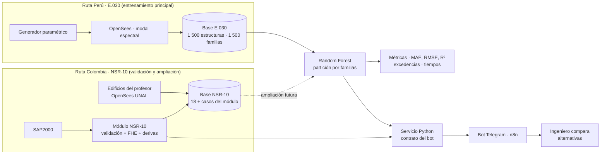

# Flujo integrado de herramientas

> **Una pregunta, dos líneas de evidencia, una interfaz.** Todo lo que se construyó encaja en este flujo; lo que no encaja se presenta como trabajo futuro.

## Qué aporta cada herramienta a la pregunta de investigación
| Herramienta | Responde | Evidencia para el informe | Responsable | Estado |
|---|---|---|---|---|
| Generador + OpenSees (E.030) | ¿De dónde salen los datos de entrenamiento? | Familias, supuestos, modelo 3D, tabla de una familia | Alexis / Jean Piere | ✅ 1 500 estructuras ([[Ruta E030 - repositorio de Piero]]) |
| Random Forest | **¿Con qué precisión se estiman las derivas de familias nuevas?** (pregunta central) | MAE, RMSE, R², calculado vs predicho, excedencias | Jean Piere / Nicolás | NSR-10 ✅ · E.030 ✅ |
| Módulo NSR-10 (prototipo B) | ¿Cómo se obtiene una respuesta de referencia confiable y trazable en Colombia? | 3 pruebas, validación contra Excel/SAP, ficha | Nicolás | **Listo** |
| Base NSR-10 | ¿Cómo se amplía el predictor a Colombia? | 19 registros con esquema común | Nicolás + Jean Piere | Lista (18 profesor + 1) |
| Bot n8n | ¿Cómo lo usaría un ingeniero? | Arquitectura y contrato del servicio | Jean Piere | Diseño listo; servicio pendiente |
| Medición de tiempos | ¿Cuánto tiempo ahorra? | Tiempo SAP/OpenSees vs predicción | Joseph | Pendiente |

## Historia del informe (coherencia y cohesión)
1. **Problema:** comparar alternativas exige repetir análisis.
2. **Pregunta:** precisión de Random Forest en familias nuevas y ahorro de tiempo.
3. **Método:** datos paramétricos (E.030) → Random Forest con partición por familias; en paralelo, un módulo NSR-10 verificable que produce respuestas de referencia y nuevos registros.
4. **Resultados:**
   - R1 — Precisión del predictor en plantas/familias no vistas. **NSR-10 (hecho):** MAE de deriva 0.086 % (X) y 0.101 % (Y), −39 % frente a la referencia; detecta 3 de 7 casos cerca del límite. **E.030 (hecho):** 300 familias reservadas, deriva MAE 0,026 % y R² 0,995 (Gradient Boosting; Random Forest R² 0,989 en CV), 139 de 146 excedencias detectadas (Jean Piere).
   - R2 — Prototipo NSR-10: reproduce el cálculo de referencia (Vs = 23 250 kN, derivas 0.985 / 0.991 %, Q = 0.0165) y bloquea entradas incompletas o erróneas (Nicolás).
   - R3 — Base NSR-10 con 19 registros (18 teóricos del profesor + 1 verificado); periodo: regresión lineal 7.2 % de error frente a 13.2 % de la fórmula Ta (Nicolás).
   - R4 — Tiempos medidos: cálculo NSR-10 < 1 ms, predicción 32 ms; flujo SAP2000 sin cronometrar (Joseph).
5. **Discusión:** límites del dominio, rutas no mezcladas, datos provisionales.
6. **Conclusión:** responde la pregunta con R1 y R4; R2 y R3 muestran cómo se lleva a la práctica en Colombia.

## Reglas de coherencia (para todos)
- Mismo título, pregunta y cifras en informe, PPT y videos.
- E.030 y NSR-10 **no se mezclan** para entrenar; se presentan como dos líneas.
- Toda cifra lleva su procedencia: calculado, importado de SAP, del profesor o provisional.
- El bot se presenta como **interfaz propuesta** con su contrato, no como sistema en producción.
